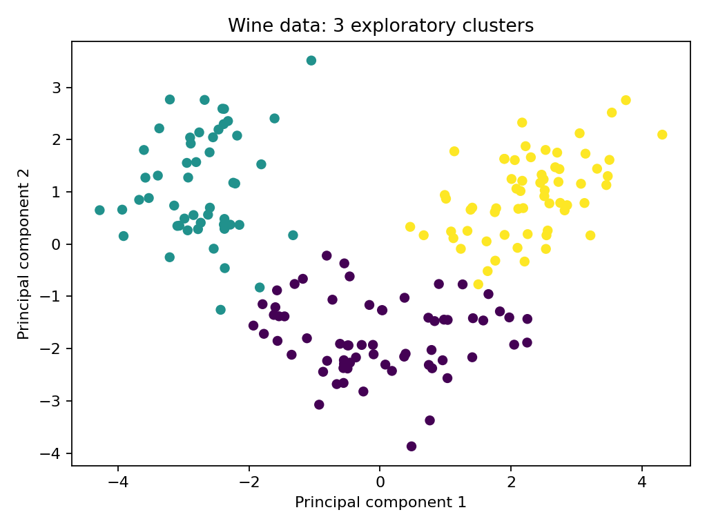

# Unsupervised Wine Data Exploration

An educational AI portfolio project prepared for Moamen Dahshan with AI assistance.

## Method and limitations

Explores the bundled wine chemical analysis dataset using standardisation, KMeans and PCA. The cluster count is chosen by silhouette score without using reference class labels. Adjusted Rand score is calculated afterwards for descriptive comparison. This is full dataset exploratory analysis, not held out predictive evaluation; clusters are not causal discoveries.

## Run

Python 3.11 or newer recommended. From this folder:

```bash
python -m venv .venv
# Activate the environment for your operating system
python -m pip install -r requirements.txt
python train.py
```

Results and plots are written to `results/`. Random seed: 42. Dependency and platform differences can affect results. No dataset downloads or API keys are required.

## Source

[Official scikit learn documentation](https://scikit-learn.org/stable/modules/generated/sklearn.datasets.load_wine.html)

## Development notes

Code and documentation were prepared with AI assistance. This is a new portfolio demonstration, not an earlier employment or competition achievement. Review and understand the workflow before presenting it as personal expertise.

## Recorded run

```json
{
  "samples": 178,
  "selected_k": 3,
  "silhouette_by_k": {
    "2": 0.2593169555318255,
    "3": 0.2848589191898987,
    "4": 0.2586075384934024,
    "5": 0.23152834284691684,
    "6": 0.23716725754166543
  },
  "adjusted_rand_vs_reference": 0.8974949815093207
}
```


